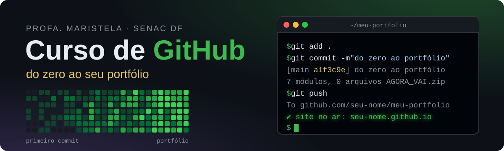

<p align="center">
  
</p>

<p align="center">
  
  
  
  
</p>

<p align="center">
  <b><a href="https://maristelaoliveira.github.io/curso-github/">🌐 Abrir o curso</a></b>
  &nbsp;·&nbsp;
  <b><a href="https://maristelaoliveira.github.io/curso-github/#m4">🧪 Ir direto para o simulador de terminal</a></b>
  &nbsp;·&nbsp;
  <b><a href="https://maristelaoliveira.github.io/curso-github/certificado.html">🎓 Ver meus certificados</a></b>
</p>

---

## `$ git log --oneline`


Prazer, eu sou a **Profa. Maristela**, ou só **Stela**! 👋

Boas-vindas ao **Curso de GitHub: do zero ao portfólio**, para os alunos da **Faculdade de Tecnologia e Inovação Senac DF**.

Todo projeto das minhas disciplinas vai morar no GitHub. Neste curso você aprende, passo a passo, a criar a sua conta, publicar os seus projetos e deixar tudo com cara de profissional. São umas **2 horas**, no seu ritmo, em quantas vezes quiser.

Este repositório é o **site do curso**. Nada de slides: aqui você aprende clicando, arrastando e digitando comando de verdade.

```text
$ git log --oneline --reverse
a1f3c9e Cria a conta no GitHub 🎉
7be20d4 Primeiro repositório
c04d81a Adiciona o README
e9a7f12 Envia o projeto da disciplina
3d8b0c5 Publica o site no GitHub Pages
9f21e6a Atualiza o portfólio
b7c44d1 (HEAD -> main) Entrega o projeto final ✔
```

> 😅 Antes do curso, o histórico era assim: `projeto_final.zip`, `projeto_final_v2_corrigido.zip`, `projeto_final_AGORA_VAI_2 (1).zip`... O Git veio para acabar com isso.

---

## 🧭 O que tem no site

| | Ferramenta | Para que serve |
|:-:|---|---|
| ⏳ | **Viagem no tempo** | Você clica nos commits de um projeto e vê o arquivo mudando, versão por versão. |
| 🔎 | **Teste do nome de usuário** | Confere se o seu nome no GitHub está com cara de profissional. |
| 📁 | **Simulação de upload** | Você arrasta os arquivos para o repositório e faz o commit pelo site, sem medo de errar. |
| 🧪 | **Simulador de terminal** | Missões com `git status`, `add`, `commit`, `push` e `log`. Você vê os arquivos andando até o GitHub. |
| ✨ | **Gerador de README** | Você preenche, ele monta o README e mostra ao vivo como fica no GitHub. Dá para copiar ou baixar. |
| 🔗 | **Montador do link do Pages** | Você digita o usuário e o repositório e descobre o endereço do seu site. |
| ✅ | **Checklist e mensagem de entrega** | As regras de entrega, o checklist e a mensagem pronta para mandar o link. |
| ❓ | **Quizzes** | Perguntas curtas no fim de cada módulo, com a explicação de cada resposta. |
| 🎓 | **Certificados** | Você digita o seu usuário do GitHub e vê os certificados que já conquistou. |

- **Progresso salvo:** o anel no menu mostra quanto do curso você já concluiu. Fica salvo no seu navegador.
- **Windows ou Mac:** a chave no menu troca as instruções e os atalhos para o seu computador.

---

## 🗺️ A trilha

Sete módulos, do primeiro commit ao portfólio no ar:

| Módulo | Tema | Tempo | |
|:-:|---|:-:|:-:|
| 1 | Por que GitHub? | 10 min | [abrir](https://maristelaoliveira.github.io/curso-github/#m1) |
| 2 | Criando sua conta (verificação em duas etapas, e-mail da faculdade e benefícios de estudante) | 25 min | [abrir](https://maristelaoliveira.github.io/curso-github/#m2) |
| 3 | Primeiro repositório (pelo site) | 15 min | [abrir](https://maristelaoliveira.github.io/curso-github/#m3) |
| 4 | Git + VS Code: o dia a dia | 30 min | [abrir](https://maristelaoliveira.github.io/curso-github/#m4) |
| 5 | README caprichado | 20 min | [abrir](https://maristelaoliveira.github.io/curso-github/#m5) |
| 6 | GitHub Pages | 15 min | [abrir](https://maristelaoliveira.github.io/curso-github/#m6) |
| 7 | Entregando projetos | 10 min | [abrir](https://maristelaoliveira.github.io/curso-github/#m7) |

> 🏋️ **Prática com correção automática:** os módulos 3, 4 e 7 têm uma prática no seu próprio GitHub. Eu confiro cada passo, dou o feedback e libero o próximo. O link da prática chega pela sua turma. Concluiu? O certificado aparece na página **Meus certificados**.

O ciclo de todo dia, que você treina no simulador do módulo 4:

```text
✏️ edite  →  ➕ git add  →  📸 git commit  →  ☁️ git push
```

---

## 🛠️ Ferramentas do curso

<p align="center">
  
</p>

| Ferramenta | Para quê |
|---|---|
|  **GitHub** | Guardar os projetos, mostrar o portfólio e entregar os trabalhos. |
| 📸 **Git** | Tirar as "fotos" (commits) do projeto no seu computador. |
| 💻 **VS Code** | Programar e enviar as mudanças com um clique (**Sync Changes**). |
| 📝 **Markdown** | Escrever o README, a capa do projeto. |
| 🌐 **GitHub Pages** | Publicar o seu site de graça, em `seu-usuario.github.io/repositorio/`. |
| 🔐 **App autenticador** | A verificação em duas etapas da sua conta. |
| 🎁 **GitHub Education** | Os benefícios de estudante: GitHub Pro e GitHub Copilot, de graça. |

<p align="center">
  
  
  
  
</p>

Sem framework, sem build e sem `npm install`. Só HTML, CSS e JavaScript puros. E este curso está no GitHub Pages, igualzinho ao site que você vai publicar no módulo 6. 😄

---

## 🤖 IA com consciência

Com os benefícios de estudante, você ganha o **GitHub Copilot**. Ele é ótimo para explicar um erro, sugerir uma mensagem de commit ou revisar o README.

Mas quem entende o projeto é você. Leia o que a IA sugeriu, teste e só então faça o commit. Se você não sabe explicar o código, ele ainda não é seu. 💪

---

## 🙋 Dicas de sobrevivência

1. **Commit bom diz o que mudou.** "Adiciona o formulário de contato" é bom. "update", "asdf" e "agora vai" não são. 😅
2. **Senha não vai para o GitHub.** Coloque o `.env` no `.gitignore`. Enviou sem querer? Apagar não basta: troque a senha.
3. **Guarde os códigos de recuperação fora do celular.** Trocou de celular sem eles? A conta fica trancada.
4. **Commit ao longo do projeto.** Um commit só no último dia não mostra o seu processo.
5. **Confira antes de entregar.** Abra o link numa aba anônima ou no celular e veja se está tudo lá.
6. **Travou?** Digite `git status`. Ele sempre conta onde você está.

```text
$ git commit -m "entrega final"
On branch main
Changes not staged for commit:
        modified:   index.html

no changes added to commit (use "git add" and/or "git commit -a")
```

> Esqueceu o `git add`? Acontece com todo mundo. Prepare os arquivos e tente de novo. 🔁

---

<details>
<summary><b>👩‍🏫 Para a professora (estrutura do repositório e como editar)</b></summary>

<br>

Site estático publicado no GitHub Pages a partir da branch `main`, sem build.

```text
curso-github/
├── index.html          # o curso: cada módulo é uma <section class="modulo" id="mN">
├── certificado.html    # Meus certificados (bloco CONFIG e lista CURSOS no <script>)
├── painel.html         # Painel da turma, para a TV da sala (lista CURSOS e tempos em CONFIG)
├── css/style.css       # o visual inteiro; as cores ficam nas variáveis do :root
├── js/main.js          # dados e funções do curso (procure "PARA EDITAR")
└── assets/             # memoji, estrela, favicon, logo, assinatura, selos e o banner deste README
```

### Como editar

| Quero mudar... | Onde |
|---|---|
| Textos dos módulos | `index.html` (cada módulo é uma `<section class="modulo">`) |
| Trechos só de Windows ou só de Mac | `<span class="so-win">` e `<span class="so-mac">` no `index.html` |
| Regras de entrega e checklist | `js/main.js`: `REGRAS_ENTREGA` e `CHECKLIST` |
| Perguntas dos quizzes | `js/main.js`: `QUIZZES` (`certa` é a posição da resposta certa, começando em 0) |
| Missões do simulador | `js/main.js`: `MISSOES` |
| Versões da viagem no tempo | `js/main.js`: `VERSOES` |
| Modelo do README gerado | `js/main.js`: função `modeloReadme` |
| Mensagem de entrega | `js/main.js`: função `montarMensagem` |
| Cores | Variáveis no topo do `css/style.css` (`:root`) |

### 🎓 Certificados (`certificado.html`)

São 4: um para cada prática com correção automática e um da **trilha completa** (as três).

- **Verificação automática:** a página confere no GitHub se o aluno concluiu de verdade (a issue do robô fechada com `concluido`). Trocar o nome no endereço não gera certificado.
- **Botões:** baixar a imagem em PNG em todos. O **LinkedIn** (adicionar ao perfil e compartilhar com texto pronto, citando @Maristela Oliveira e @Faculdade Senac DF) só aparece no certificado da trilha completa; nos outros aparece o progresso da trilha. Para liberar em todos: `linkedinSoNaTrilha: false` no `CONFIG`.
- **Comemoração:** a mensagem final do robô em cada prática mostra o selo da conquista com confete e o link do certificado.
- **Para editar** o nome do evento, os nomes das menções e os links: bloco `CONFIG` no `certificado.html`. As práticas ficam na lista `CURSOS`.

### 📺 Painel da turma (`painel.html`)

Mostra, ao vivo, quem começou as práticas e em que passo cada aluno está. Atualiza sozinho a cada minuto.

- **Em amarelo, no topo:** alunos parados no mesmo passo há 8 minutos ou mais (talvez precisem de ajuda).
- **Quando alguém conclui uma prática:** aviso na tela com confete 🎉
- **Turma grande:** o painel rola sozinho e volta ao topo.

| Endereço | Mostra |
|---|---|
| `painel.html` | Alunos que começaram hoje |
| `painel.html?desde=2026-10-20` | Alunos que começaram desde essa data |
| `painel.html?demo=1` | Demonstração com alunos de mentira (`?demo=40` para uma turma grande) |

Os dados vêm da busca pública do GitHub (as issues que o robô abre em cada repositório de aluno), sem login. Só aparecem repositórios **públicos**.

### Rodar localmente

Abra o `index.html` no navegador. Sem internet, só a pré-visualização do README mostra o texto puro (as bibliotecas `marked` e `DOMPurify` vêm de CDN).

Antes de publicar: teste no navegador, também na largura de celular (390 px).

</details>

---

<p align="center">
  Feito com ♥ e sucata eletrônica pela <a href="https://maristelaoliveira.github.io/">Profa. Maristela</a> · Faculdade de Tecnologia e Inovação Senac DF
  <br>
  <code>git push origin portfolio</code> 🚀
</p>
